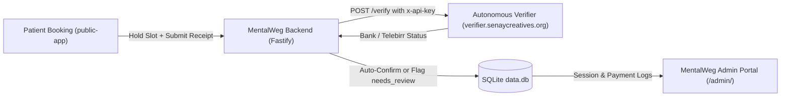

# MentalWeg Admin System Architecture & Roadmap Recommendations

This document outlines strategic recommendations and implementation blueprints for the MentalWeg Clinical & Practice Administration suite (`/admin/`).

---

## 1. System Decoupling & Microservice Bridge

- **Standalone Verifier Endpoint**: `https://verifier.senaycreatives.org`
- **Authentication**: Managed via dynamic database settings ([`SettingsSchema`](file:///D:/Apps/2019/mentalweg/src/services/settings.service.ts)) with `.env` fallback.
- **Admin Configuration**: Dedicated Verifier API key management tab in Admin Settings with live connection testing.

---

## 2. Admin Feature Recommendations by Domain

### A. Payment & Settlement Intake (`MoneyPage.tsx` & `IntakePage.tsx`)

1. **`needs_review` Inspection Desk**:
   - When a receipt cannot be verified automatically (e.g. illegible slip, network timeout, or foreign geoblock), it is assigned status `needs_review`.
   - **Recommended Feature**: Add a dedicated "Needs Review" queue showing:
     - Side-by-side screenshot viewer with rotation and zoom controls.
     - Extracted receipt reference and credited account numbers.
     - 1-click **"Re-verify with Verifier API"** button.
     - 1-click **"Manual Confirm"** button (logs "Confirmed manually by Admin" into the audit trail).
2. **Revenue & Settlement Dashboard**:
   - Monthly and weekly breakdown:
     - Total Scheduling Fees Collected (ETB).
     - Outstanding In-Person Balance per Patient.
     - Provider breakdown (Telebirr vs CBE vs Cash).
   - CSV / Excel export for practice accounting and tax reports.

---

### B. Calendar & Scheduling Engine (`CalendarPage.tsx` & `TodayPage.tsx`)

1. **Today's Clinic Flow (Kiosk / Quick-Action View)**:
   - Dedicated fast check-in toggle: `Arrived`, `In Session`, `Completed`, `No-Show`.
   - Visual indicator showing whether the initial fee was verified via Telebirr/CBE or paid cash in person.
2. **Ethiopian Calendar Dual Display**:
   - Integrate an Ethiopian Calendar toggle (e.g. `ethiopian-date-converter`) so the therapist can view Ethiopian Meskerem–Pagume dates alongside Gregorian dates.
3. **Emergency Slot Block-Out Wizard**:
   - 1-click tool to block off an afternoon or date range with an optional automated SMS/email notice to affected clients offering quick rescheduling links.

---

### C. Patient CRM & Clinical Notes (`ClientsPage.tsx`)

1. **Unified Patient Timeline**:
   - Detailed patient profile containing:
     - Full booking history with payment status.
     - Reschedule and cancellation audit log.
     - Intake questionnaire answers.
2. **Encrypted Session Notes**:
   - Encrypted clinical notes field per appointment with auto-save drafts.
   - Print-friendly clinical referral note generator.
3. **Smart Phone Lookup**:
   - Normalize searches across `09...`, `07...`, `+251...`, and international formats.

---

### D. Settings & Practice Operations (`SettingsPage.tsx`)

1. **Verifier Microservice Panel** (Implemented):
   - Direct input for `verifierBaseUrl` and `verifierApiKey`.
   - Live **"Test Connection"** diagnostic probe checking health latency and key authorization.
2. **Automated Notification Templates**:
   - Customizable email templates for:
     - Appointment Confirmation (with Google Calendar / iCal link).
     - 24-Hour Reminder.
     - Practice address directions & arrival guidelines.
3. **Database Health & Backup Monitor**:
   - Display timestamp of the latest automated SQLite `.backup` snapshot.
   - 1-click **"Download Database Snapshot"** button for offline safekeeping.

---

### E. Mobile Experience & Offline PWA

1. **Haptic & Gesture Interactions**:
   - Swipe left on appointments to reschedule.
   - Swipe right to mark as completed.
2. **Offline-First Patient Emergency Roster**:
   - Cache today's appointments and contact numbers in IndexedDB / ServiceWorker so the practitioner can access patient info even during internet dropouts.

---

### F. Implemented: Receipt Inspection & Payment Decision Modal (`PaymentReviewModal.tsx`)

- **Problem Addressed**: Previously, clicking "Confirm Manually" immediately approved bookings without allowing the admin to inspect the receipt screenshot or cancel invalid payments.
- **Solution Delivered**:
  - Replaced ambiguous immediate buttons on [TodayPage.tsx](file:///D:/Apps/2019/mentalweg/admin/src/pages/TodayPage.tsx), [CalendarPage.tsx](file:///D:/Apps/2019/mentalweg/admin/src/pages/CalendarPage.tsx), and [ClientsPage.tsx](file:///D:/Apps/2019/mentalweg/admin/src/pages/ClientsPage.tsx) with **"Review & Decide"**.
  - Opens [PaymentReviewModal.tsx](file:///D:/Apps/2019/mentalweg/admin/src/components/PaymentReviewModal.tsx) displaying:
    - Client details (name, phone, email).
    - Appointment time & date in EAT time.
    - Transfer provider badge (Telebirr, CBE, Dashen, etc.) & amount.
    - Reference code with 1-click clipboard copy.
    - Receipt slip screenshot (with zoom-in and open full size in new tab). If no screenshot was uploaded, displays a clear placeholder note.
    - **Accept & Confirm Payment** button: marks payment verified and confirms session.
    - **Reject Payment & Cancel Slot** button: prompts for rejection reason, marks payment rejected, releases the session slot, and removes it from pending review queue.
  - Backend API endpoints: `POST /api/admin/payments/:id/confirm` and `POST /api/admin/payments/:id/reject` in [src/routes/admin.ts](file:///D:/Apps/2019/mentalweg/src/routes/admin.ts).

